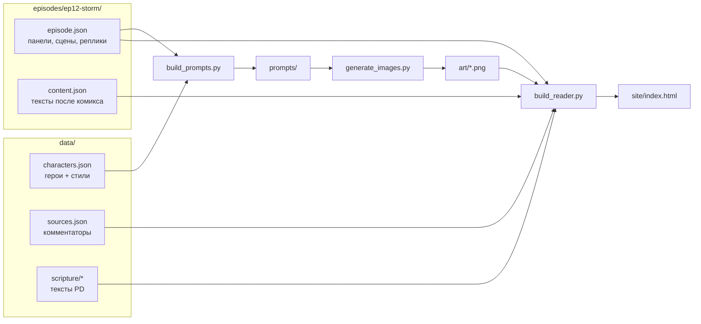

# Архитектура

## Главная идея: всё раздельно

Один эпизод даёт **8 вариантов** (2 традиции × 2 возраста × 2 языка), а с новыми языками ещё больше. Чтобы не рисовать и не писать одно и то же 8 раз, каждая часть хранится отдельно и собирается в читалке:



## Слои

| Слой | Зависит от | Где |
|---|---|---|
| **Картинка** (без текста!) | возраст (2 стиля) | `art/<style>/<episode>/<panel>.png` |
| **Нимб** | традиция | `<panel>.orthodox.png` (PNG) или `<g class="nimbus">` (SVG-эскиз) |
| **Реплики и подписи** | возраст + язык | `episode.json → panels[].bubbles.<age>[].text.<lang>` |
| **Текст Писания** | язык | `data/scripture/<translation>/mark.json` |
| **Что произошло + фон** | возраст + язык | `content.json → shared.<age>.<lang>` |
| **Учителя, главная мысль, применение, вопросы, стих, молитва** | традиция + возраст + язык | `content.json → <tradition>.<age>.<lang>` |

Поэтому:
- **12 картинок** на эпизод (6 панелей × 2 стиля) + ~6 вариантов с нимбом — а не 48.
- Новый язык = перевести реплики и `content.json`, картинки не трогать.

## Пузыри

Текст никогда не рисуется в картинке. В `episode.json` у каждой реплики есть:

```json
{ "kind": "speech", "who": "jesus", "x": 50, "y": 6, "w": 34, "tx": 68, "ty": 57,
  "text": { "en": "Let's go across to the other side!", "ru": "Давайте переплывём на ту сторону!" } }
```

`x, y, w` — положение и ширина в процентах от панели, `tx, ty` — куда смотрит хвостик (на говорящего). Виды: `caption` (подпись рассказчика), `speech`, `shout`, `whisper`, `sfx` (звук). После генерации настоящих картинок координаты хвостиков нужно подправить под новую композицию.

## Правила для текста

1. Слова Иисуса и учеников в комиксе — только по тексту Марка (у детей — упрощённо, но без нового смысла). Придуманных реплик нет.
2. Подписи рассказчика могут пересказывать, но ничего не добавлять к событиям.
3. Всё, что сказали учителя, помечено `kind: paraphrase` + `verify: true`, пока не сверено с источником.

## Добавить новый эпизод

1. Скопировать `episodes/ep12-storm/` в `episodes/epNN-name/`.
2. Заполнить `episode.json` (панели, сцены, реплики) и `content.json`.
3. `python3 tools/build_prompts.py epNN-name` → сгенерировать картинки → `python3 tools/build_reader.py`.
4. Пройти [REVIEW_CHECKLIST.md](REVIEW_CHECKLIST.md).
5. В `data/episodes.json` поменять `status`.

## Публикация

`site/index.html` — один файл; работает с диска, на GitHub Pages или любом статическом хостинге. Дальше можно: PDF для печати (по странице на 6 панелей), EPUB, мобильное приложение — всё читает те же JSON.
